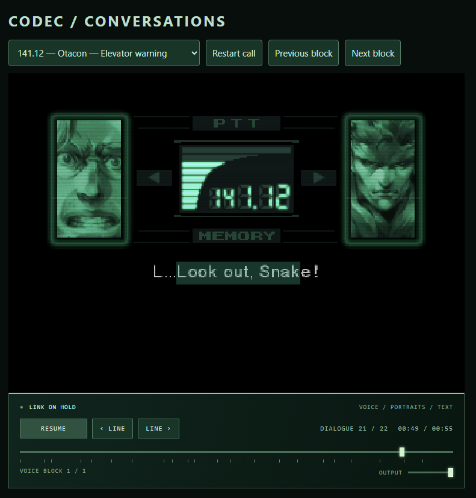

# MGS1 Browser Codec

An experimental Metal Gear Solid: Integral Codec demo in the browser, using recovered C compiled to WebAssembly.



**[Try the hosted demo](https://mgs1-browser-codec.netlify.app/)**

The hosted demo includes selected conversations and contains story spoilers. This repository provides source code and a utility to extract the required assets locally from your own Integral discs. Retail assets are not included in the repository.

## Features

- Eleven selected conversations, 35 voice blocks and 549 captions.
- Recovered C routines for frame geometry, simple portrait animation, voice cues and the panel/meter.
- Original voices and portraits imported from local discs.
- Selected full portrait animation sequences.
- Playback controls, dialogue navigation and selectable subtitles.
- Optional CRT presentation effects.

## Run locally

Requirements:

- Python 3.12 and Pillow.
- FFmpeg with `libmp3lame`.
- Zig 0.14.1.
- Your own Japanese/Asia Integral Disc 1 and Disc 2 raw MODE2/2352 BIN images.

Install the Python dependency:

```sh
python -m pip install -r requirements.txt
```

Import assets from your discs:

```sh
python tools/import_assets.py --disc1 "PATH/Integral Disc 1.bin" --disc2 "PATH/Integral Disc 2.bin" --ffmpeg "PATH/ffmpeg"
```

Build the WebAssembly module:

```sh
python tools/build_wasm.py --zig "PATH/zig"
```

Serve the browser files:

```sh
python -m http.server 8769 --bind 127.0.0.1 --directory web
```

Open **http://127.0.0.1:8769/**, select a conversation and press Play.

Windows has been tested. Other operating systems remain unverified. Opening the HTML directly without an HTTP server is unsupported.

## Supported discs and extraction

The importer checks Integral serials **SLPM_862.47** and **SLPM_862.48**, plus pinned executable and resource SHA-256 hashes. Similarly named regional releases are not assumed compatible.

Current support is limited to the tested Japanese/Asia Integral revision and its English dialogue resources.

- Supply raw BIN images; CUE parsing, cooked ISO, CHD and multitrack offset translation are unsupported.
- No BIOS is required.
- The importer does not download content or modify your discs.
- Generated assets and extraction records go into ignored `web/assets/`.
- Existing output is never overwritten. Move that directory aside before importing again.
- Failed imports preserve partial output for diagnosis.

Do not commit generated assets, disc images or private import records.

## Limitations

This is a standalone prototype, **not the complete Codec scripting engine or a browser port of the game**.

Recovered C handles selected routines. JavaScript and Canvas handle presentation, audio playback and approximate event scheduling.

- Audio is converted locally from ADPCM to MP3.
- Original SPU mixing, reverb and ambient audio are not reproduced.
- Portrait scheduling, fades, scan effects and static are approximations.
- Conditional scripts, interruptions, call opening/closing and some sound effects remain incomplete.
- RADIO dialogue and VOX captions are paired only for the selected, checked blocks.
- Audiovisual timing and transitions have not been verified equivalent to original gameplay.

Passing the included checks establishes selected behavior and internal consistency, not complete PlayStation accuracy.

## Tests

After importing assets:

```sh
python -m unittest discover -s tests -p "test_*.py"
python tools/build_wasm.py --zig "PATH/zig" --native-fixture
node tests/test_portraits.js
node tests/test_static.js
node tests/test_calls.js
```

The JavaScript checks require Node.js.

See [VERIFICATION.md](VERIFICATION.md) for recorded results and remaining limitations.

## Credits and licensing

- **Konami and the original creators:** Metal Gear Solid / Integral, dialogue, artwork and audio.
- **[FoxdieTeam](https://github.com/FoxdieTeam/mgs_reversing):** recovered game routines.
- **[metalgeardev/MGS1](https://github.com/metalgeardev/MGS1):** asset-format research consulted during extraction work.
- **ImperishableNEET / Torment Nexus LLC:** browser adaptation, extraction integration and presentation, developed with Codex assistance.

FFmpeg, Pillow and Zig are external tools installed separately.

See [NOTICE.md](NOTICE.md) for source provenance and [LICENSE.md](LICENSE.md) for licensing scope. No blanket licence is asserted over recovered game code or original assets.

The screenshot contains original game artwork © Konami. It is a preview, not an asset bundle.

Unofficial project; not affiliated with or endorsed by Konami.
